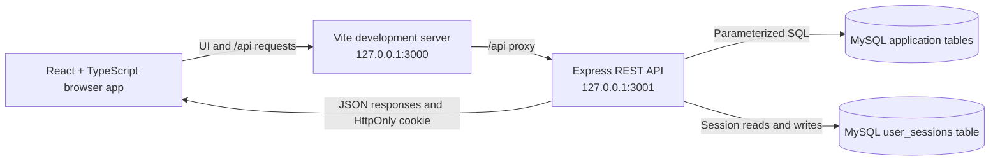

# Orale' Dental Clinic Booking Website

## Project Overview

Orale' is a dental clinic appointment booking website built as a software development portfolio project. It combines a React and TypeScript user interface with a Node.js/Express REST API and a MySQL database.

The project demonstrates frontend and backend integration, session-based patient authentication, relational data modeling, and appointment scheduling rules such as dentist working hours, time off, service duration, and buffer times. It is a portfolio and development project, not a production-ready clinical system.

## Key Features

### Implemented with the backend

- Patient registration and login using Argon2id password hashing and server-side sessions.
- Session restoration and logout using an HttpOnly cookie.
- MySQL-backed patient profiles, profile updates, and authenticated patient appointment lists.
- Appointment booking with availability validation, dentist schedules, time-off checks, service durations, and service buffers.
- Repeat authenticated bookings reuse the patient record associated with the current session.
- Authenticated patient appointment rescheduling and cancellation through patient-scoped API routes.
- Public service, dentist, working-hours, and clinic-settings catalog.
- Admin-protected appointment status, walk-in, schedule, and time-off API operations.

### Partially implemented or demo functionality

- Anonymous guest booking is supported by the API, but the anonymous booking tracker still reads and mutates demo appointments in browser `localStorage`; it is not connected to guest appointment records in MySQL.
- Dentist appointment management still reads and updates appointments in `localStorage`. The dentist view's clinician selector is a UI selection, not a separately authenticated dentist identity workflow.
- Some admin dashboard data and actions remain local: notifications and audit-log displays read from `localStorage`, and clinic settings updates are local. Other admin data and actions, including appointments, patient records, schedules, and time off, use the backend.
- Seed data is demo clinic data. The seed script does not provision administrator or dentist user accounts.
- Trusted staff-account provisioning is not implemented.

## Technology Stack

- **Frontend:** React 19, TypeScript, Vite, Tailwind CSS 4, and Lucide icons.
- **Backend:** Node.js, Express 4, TypeScript, and `tsx` for the development API runner.
- **Database:** MySQL accessed with `mysql2`.
- **Authentication and sessions:** `express-session`, `express-mysql-session`, Argon2id via `argon2`, and `express-rate-limit`.
- **Development and verification:** npm, Vite, and TypeScript's `tsc --noEmit` check.

## System Architecture

The browser renders the React application. Vite proxies `/api` requests to the local Express API during development. The API validates requests, applies authentication and role checks where required, runs parameterized MySQL queries, and returns JSON. MySQL stores application records and server-side session data.

Patient authentication uses a MySQL-backed Express session. After login, the server regenerates the session ID and returns an HttpOnly cookie; browser code sends it with credentialed API requests. Patient identity and ownership checks are derived from the session on the server, not from a patient ID supplied by the UI. Cookie-authenticated mutations check the configured application origin.



## Database Overview

The base schema is in [`database/schema.sql`](./database/schema.sql). The authentication migration adds `users` and `user_sessions`, plus a unique nullable `patients.user_id` relationship to `users.id`. Existing unlinked patient records are not automatically associated with accounts.

| Table | Purpose and relationships |
|---|---|
| `services` | Dental service catalog, duration, buffer, pricing, and booking metadata. |
| `dentists` | Dentist and clinician profile/catalog data. |
| `dentist_services` | Many-to-many assignments between dentists and services. |
| `working_hours` | Per-dentist weekly schedule, including breaks and working-day status. |
| `time_off` | Dentist unavailability date ranges. |
| `patients` | Patient profile and contact/medical fields; optionally linked to one `users` account. |
| `appointments` | Booking, status, date/time, and links to patient, dentist, service, and an optional source appointment for rescheduling. |
| `notifications` | Notification records linked to appointments. |
| `audit_logs` | Recorded appointment, schedule, and other supported administrative actions. |
| `clinic_settings` | Clinic-wide contact, scheduling, and booking settings. |
| `users` | Authentication identity, normalized unique email, password hash, role, and account status. |
| `user_sessions` | Persistent server-side Express session records. |

Important relationships include `appointments.patient_id` to `patients.id`, `appointments.dentist_id` to `dentists.id`, and `appointments.service_id` to `services.id`. The authentication migration adds `patients.user_id` to `users.id`. See [`database/README.md`](./database/README.md) for local database setup.

## API Overview

All routes are implemented in [`server/index.ts`](./server/index.ts). JSON responses are used throughout. “Patient” and “admin” below refer to server-authenticated roles; frontend view selection is not authorization.

### Authentication

| Method | Endpoint | Purpose and access |
|---|---|---|
| `POST` | `/api/auth/register` | Public, rate-limited patient registration. Registration always assigns the patient role. |
| `POST` | `/api/auth/login` | Public, rate-limited login; verifies credentials and creates a server session. |
| `POST` | `/api/auth/logout` | Destroys the current session; checks request origin. |
| `GET` | `/api/auth/me` | Returns the current account and, for patients, the associated profile; returns `401` when unauthenticated. |

### Patient

| Method | Endpoint | Purpose and access |
|---|---|---|
| `GET` | `/api/patient/profile` | Authenticated patient reads their own profile. |
| `PATCH` | `/api/patient/profile` | Authenticated patient updates their own profile; checks request origin. |
| `GET` | `/api/patient/appointments` | Authenticated patient reads appointments associated with their account. |
| `POST` | `/api/patient/appointments/:id/reschedule` | Authenticated patient reschedules an eligible appointment they own; checks availability and request origin. |
| `POST` | `/api/patient/appointments/:id/cancel` | Authenticated patient cancels an eligible appointment they own; checks request origin. |

### Appointments and availability

| Method | Endpoint | Purpose and access |
|---|---|---|
| `GET` | `/api/availability` | Public availability query using service, date, and optional dentist parameters. Excluding an existing appointment is restricted to an authenticated patient and verified against ownership. |
| `POST` | `/api/appointments` | Creates a booking for a guest or authenticated patient; validates the slot in a transaction. |
| `PATCH` | `/api/appointments/:id/status` | Admin-only appointment status update. |

### Admin

These mutations require an authenticated admin role and an allowed request origin.

| Method | Endpoint | Purpose |
|---|---|---|
| `POST` | `/api/admin/walk-in-appointments` | Creates a walk-in appointment. |
| `PUT` | `/api/admin/working-hours` | Creates or updates dentist working hours. |
| `POST` | `/api/admin/time-off` | Creates dentist time off. |
| `DELETE` | `/api/admin/time-off/:id` | Deletes a time-off record. |

### Public and clinic data

| Method | Endpoint | Purpose and access |
|---|---|---|
| `GET` | `/api/public/clinic-data` | Public catalog containing active services/dentists, working hours, and clinic settings; no patient or appointment records. |
| `GET` | `/api/clinic-data` | Requires authentication. Patients receive their own patient and appointment data; admins receive clinic management datasets; dentist accounts do not receive clinic-wide patient, appointment, notification, audit-log, or time-off datasets. |
| `GET` | `/api/health` | Health and database connectivity check. |

No separate dentist-specific appointment API or staff-account provisioning endpoint is implemented.

## Installation and Setup

### Prerequisites

- Node.js compatible with the installed Vite 8 toolchain (Node.js 22 LTS is a suitable choice).
- npm.
- A locally running MySQL server and a database user with permission to create/alter the project database and tables.

### 1. Install dependencies

From the repository root:

```bash
npm install
```

### 2. Configure environment variables

Copy the example file and edit the local copy. In PowerShell:

```powershell
Copy-Item .env.example .env
```

Set the MySQL connection values in `.env`. The API reads `MYSQL_HOST`, `MYSQL_PORT`, `MYSQL_USER`, `MYSQL_PASSWORD`, and `MYSQL_DATABASE`. Local development defaults in the example target MySQL on `127.0.0.1:3306` and the database `orale_clinic`; replace credentials with values for your local setup. Do not commit `.env` or put real credentials in documentation.

The API uses `APP_ORIGIN` for origin validation and `SESSION_SECRET` to sign sessions. Keep the example's placeholder secret out of production; configure a private random secret of at least 32 bytes. `API_PORT` is optional and defaults to `3001`. The Vite proxy is configured for `127.0.0.1:3001`, so changing the API port also requires changing the Vite proxy configuration.

### 3. Create and optionally seed the database

Run the base migration, followed by the authentication migration:

```bash
npm run db:migrate
npm run db:migrate:auth
```

Optionally insert the supplied demo clinic records:

```bash
npm run db:seed
```

The seed command inserts missing catalog and demo records; it does not provision user accounts. The authentication migration checks existing patient account links and does not automatically link legacy records.

### 4. Start the API and frontend

Run these in separate terminals from the repository root:

```bash
npm run dev:api
```

```bash
npm run dev
```

The API defaults to `http://127.0.0.1:3001`. The Vite app is served at `http://127.0.0.1:3000` and proxies `/api` requests to the API.

## Testing and Verification

Available project checks:

```bash
npm run lint
npm run build
```

`npm run lint` runs the TypeScript compiler with `--noEmit`; `npm run build` creates the Vite production build in `dist/`. There is no automated API test suite or Postman collection in the repository. A documented Postman collection with authorization, ownership, booking-validation, and error-case coverage is a planned portfolio improvement.

## Implementation Status and Limitations

- Authenticated patient profiles, appointment retrieval, repeat booking, rescheduling, and cancellation use the MySQL-backed API.
- Anonymous booking is supported by the backend, but anonymous guest tracking and guest appointment mutations still use browser `localStorage`; those operations are not connected to the MySQL guest records.
- Dentist appointment viewing and status changes still use `localStorage`; there is no separate dentist identity-to-dentist authorization workflow.
- Some admin notifications and audit-log display data, as well as clinic settings updates, still use `localStorage`. Other admin workflows listed above use the backend.
- Patient self-registration creates patient accounts only. Trusted admin/dentist account provisioning is not implemented.
- Demo seed data and browser-local demo data are for development. Do not use the project with real patient information or expose the development setup to a network.

## Screenshots

Application screenshots will be added here later. No screenshot paths or images are currently included in this section.
